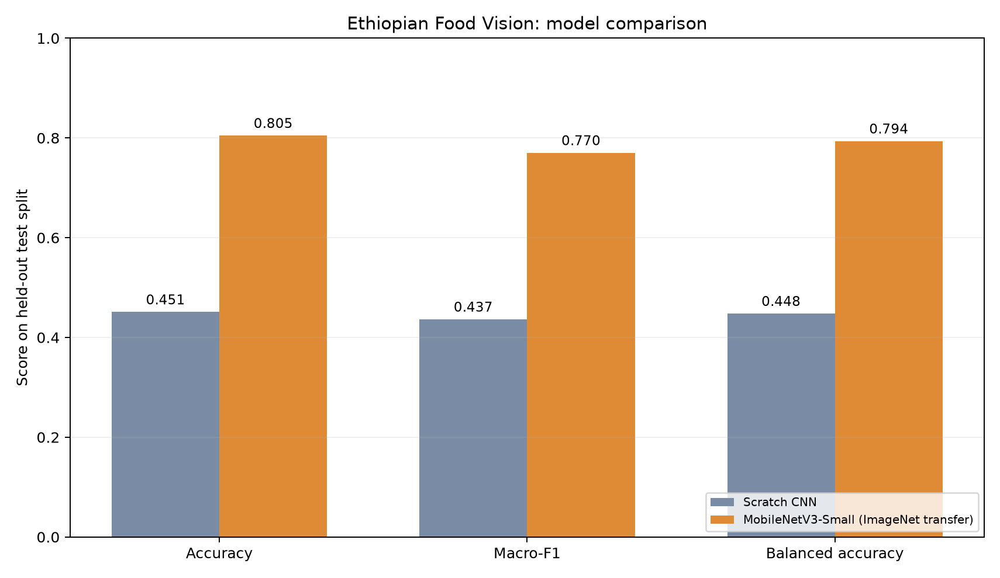

# Ethiopian Food Vision AI

A local, research-oriented image classifier for 11 Ethiopian dishes. The repository contains a dataset-preparation pipeline, train-time augmentation, a from-scratch baseline, an ImageNet transfer-learning model, a held-out evaluation and error analysis, and a Gradio inference app.

**Important data-rights constraint:** the Hugging Face source card describes social-media-collected images but does not declare a dataset license. This project uses that public mirror only for local research and does not redistribute the images or trained weights. The separately listed Roboflow collection has a CC BY 4.0 badge, but its export requires a Roboflow account key and the available evidence does not establish that it is the same copy. See [`docs/sources.md`](docs/sources.md). Accordingly, this version is not published as a Hugging Face model or Space. The Project 1 publication credential is not used here.

## What is included

- **Dataset preparation:** downloads the public 1.1K-row parquet mirror, decodes images, records provenance, removes exact duplicate bytes, and creates deterministic stratified 70/15/15 train/validation/test splits.
- **Augmentation:** random resized crops, horizontal flips, small rotations, and mild color jitter are applied only to training images. Validation/test transforms are deterministic.
- **Baseline:** a compact CNN trained from scratch.
- **Improved model:** ImageNet-pretrained MobileNetV3-Small; the classifier is trained first, then only the final three backbone blocks are fine-tuned.
- **Evaluation:** best checkpoint is selected on validation macro-F1; the test split is held out for final accuracy, macro-F1, balanced accuracy, per-class precision/recall/F1, and a confusion matrix.
- **Error analysis:** per-example test predictions with true class, predicted class, confidence, and top-three scores.
- **Inference:** local Gradio image upload interface.


## Setup

Python 3.10+ is recommended. For a small CPU-only install, create a virtual environment and install CPU PyTorch before the remaining dependencies:

```bash
python -m venv .venv
source .venv/bin/activate  # Windows: .venv\\Scripts\\activate
python -m pip install --upgrade pip
python -m pip install torch torchvision --index-url https://download.pytorch.org/whl/cpu
python -m pip install -r requirements.txt
python -m pip install -e .
```

## Prepare data

```bash
python scripts/prepare_dataset.py
```

The first run downloads about 272 MB of parquet data. Prepared images and split manifests are kept under `data/processed/`, which is ignored by Git. The source split contains only one `train` partition, so this project creates its own deterministic split using seed 42. Exact byte-identical duplicates are removed before splitting; near-duplicates and source-level grouping cannot be ruled out and remain a limitation.

## Train and compare

```bash
python -m ethiopian_food_vision.train \
  --model baseline --epochs 8 --run-name baseline \
  --output-dir artifacts/baseline

python -m ethiopian_food_vision.train \
  --model mobilenet_v3_small --epochs 8 --freeze-epochs 2 \
  --run-name mobilenet_v3_small --output-dir artifacts/mobilenet_v3_small
```

The transfer model downloads torchvision's public ImageNet weights on first run. Training history, test metrics, confusion matrix CSV/PNG, and per-image error analysis are written under `results/<run-name>/`. Checkpoints remain in `artifacts/` and are intentionally ignored by Git while data rights are unresolved. Set `--threads` and `--batch-size` to match your machine.

## Run inference

After training the transfer model:

```bash
python app.py
```

Open `http://127.0.0.1:7860`. For a different checkpoint, set `FOOD_VISION_CHECKPOINT`. The app runs on localhost and does not enable public sharing. Predictions are not an ingredient, allergen, food-safety, medical, or nutrition assessment. There is no out-of-distribution rejection, so unfamiliar images may receive confident-looking scores.

## Results and evidence

On the fixed 164-image test split, the scratch CNN reached **45.1% accuracy / 0.437 macro-F1**; ImageNet-pretrained MobileNetV3-Small reached **80.5% / 0.770 macro-F1** (balanced accuracy 0.794). This is a +35.4 percentage-point accuracy change on this one split, not a deployment guarantee. The data pipeline produced 1,093 unique images after removing four exact duplicates.



See [`docs/evaluation.md`](docs/evaluation.md) for the test protocol, per-class results, common errors, and limitations. The dataset is small, uneven, social-media-derived, and has unresolved reuse rights; near-duplicates may remain. Do not interpret this random-split result as generalization to Ethiopian cuisine or restaurant images broadly.

## Data rights, safety, and publication

No source images or weights are committed, and no public model/Space is created. A rights-cleared dataset copy (or permission to use the source for model training and derivative-weight publication) is required before distributing checkpoints or launching a public demo. The attribution for the public dataset and the separate Roboflow listing is recorded in [`docs/sources.md`](docs/sources.md).

## Tests

```bash
pytest
ruff check .
```

The tests use generated fixture images only to verify data-handling code; fixture images are not used as training or evaluation data.

## License

Original code in this repository is MIT-licensed; see [`LICENSE`](LICENSE). This code license does not apply to upstream images, ImageNet pretraining weights, or models trained from data with unresolved licensing.
